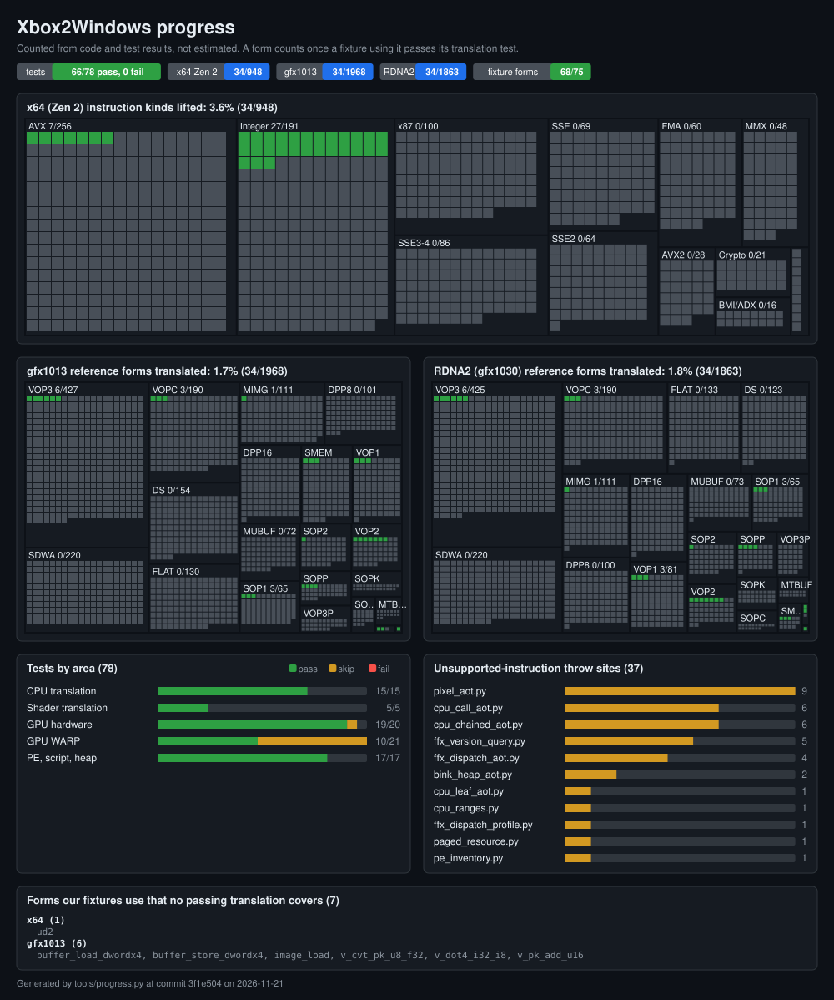

# Progress

Generated by `tools/progress.py` from a full CTest run (`ctest --preset dev --no-tests=error
--output-junit <repo>/out/test-results.xml`, then `python tools/progress.py out/test-results.xml`).
Every number is counted, and a run on another machine or adapter can give different test results.

| Metric | Now | Measured as |
|---|---|---|
| Tests | 66 pass, 0 fail, 12 skipped, of 78 | CTest JUnit results |
| x64 (Zen 2) kinds | 34/948 (3.6%) | iced-x86 mnemonics Zen 2 runs in user mode, used by a `tests/cpu/*.asm` fixture whose lifting test passed |
| gfx1013 forms | 34/1968 (1.7%) | LLVM 15 gfx1013 instruction forms (per encoding) used by a fixture whose translate-and-draw test passed |
| RDNA2 forms | 34/1863 (1.8%) | Same, against LLVM 15's gfx1030 list |
| Fixture forms | x64 34/35, gfx1013 34/40 | Forms our own fixtures use; grows as we add fixtures |

Limits: a form counts once any passing fixture contains it, even in a helper the translator didn't lift,
and one passing case doesn't prove every operand variant. The gfx1013 forms only in
`tests/ffx_dispatch_aot_check.py` are verified in upstream's Linux CI (LLVM 15), not on this machine.

## History

| Date | Commit | Tests | x64 Zen 2 | gfx1013 | RDNA2 |
|---|---|---|---|---|---|
| 2026-11-21 | `3f1e504` | 66/78 (0 fail, 12 skip) | 34/948 | 34/1968 | 34/1863 |
